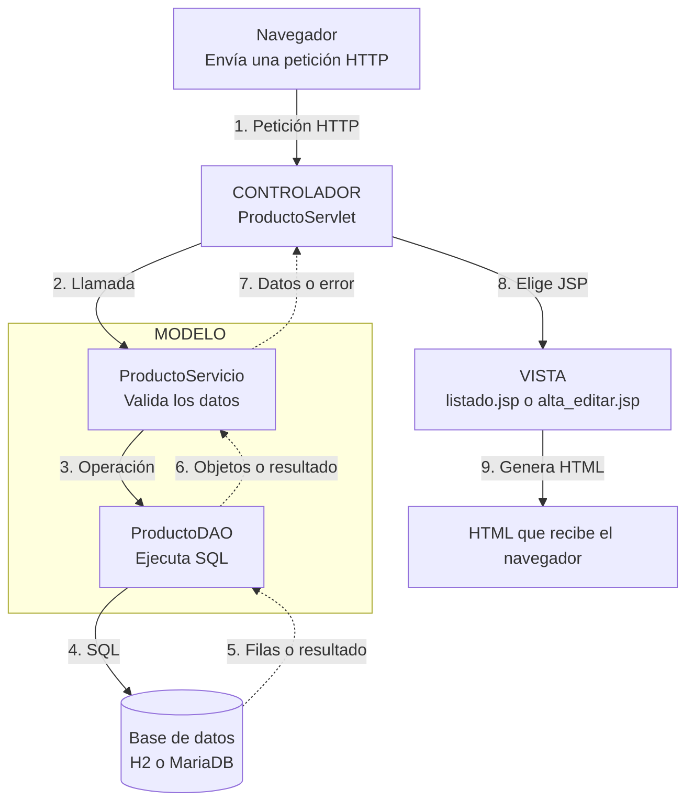

# Modelo-Vista-Controlador con servlets y JSP

Este módulo retoma el CRUD de productos de `07_JDBC` para explicar el patrón **Modelo-Vista-Controlador (MVC)**. El 07 separa las operaciones en cuatro servlets y omite la validación de negocio en Java para centrarse en JDBC. Aquí agrupamos el CRUD en un controlador, reutilizamos el formulario y validamos los datos en `ProductoServicio`. Las mismas acciones —listar, crear, editar y eliminar— permiten seguir el recorrido de una petición y reconocer qué responsabilidad tiene cada parte. H2 en archivo está seleccionado por defecto. Como en el ejemplo 07, se puede elegir MariaDB de XAMPP cambiando la implementación de la interfaz de conexión en el servlet.

## Qué vas a aprender

- Identificar modelo, vista y controlador en una aplicación web pequeña.
- Distinguir la lógica de negocio de `ProductoServicio` del acceso SQL de `ProductoDAO`.
- Seguir el recorrido desde un enlace o formulario hasta la respuesta HTML.
- Comprender por qué el controlador decide la vista y la JSP no ejecuta SQL.
- Comparar `forward` para mostrar una vista con `sendRedirect` después de modificar datos.

## Requisitos específicos

Los requisitos comunes están en el [README raíz](../README.md).

- H2 no necesita un servidor instalado. Solo para la alternativa MariaDB se requiere XAMPP con el servicio **MySQL** iniciado.

## La idea de MVC

La idea fundamental de MVC es la **separación de responsabilidades**: el modelo gestiona los datos y las reglas de negocio, la vista presenta la información y el controlador coordina las peticiones. Cada parte tiene una tarea definida y se comunica con las demás mediante métodos y datos acordados, sin necesitar conocer sus detalles internos.

Esta separación facilita que el código sea **mantenible**: permite localizar errores y modificar una parte reduciendo el impacto sobre las demás. También favorece el trabajo en equipo, porque distintos programadores pueden encargarse de partes diferentes. Para colaborar, deben acordar cómo se comunican —qué métodos ofrecen, qué datos reciben y qué devuelven—, sin necesitar conocer todos los detalles de su implementación interna.

Vamos con las diferentes partes del **MVC**:

| Parte | Archivos del módulo | Responsabilidad |
|---|---|---|
| Modelo | `modelo/entidad/Producto.java`, `modelo/servicio/ProductoServicio.java` y `modelo/persistencia/`, con `ProductoDAO`, las dos conexiones y su interfaz | Representar productos, aplicar reglas y leer o modificar los datos. No genera HTML ni decide qué página mostrar. |
| Vista | `WEB-INF/vistas/listado.jsp` y `alta_editar.jsp` | Presentar los atributos que le entrega el controlador. No abre conexiones JDBC. |
| Controlador | `controlador/ProductoServlet.java` | Interpretar la ruta y los parámetros HTTP, llamar al servicio y elegir la vista, la redirección o el estado HTTP. No conoce el DAO. |

**Nota:** `index.html` es la página pública de entrada. No forma parte del recorrido del CRUD y tiene un enlace a `/productos`.

El modelo se organiza en tres partes:

| Parte del modelo | Responsabilidad general | Qué no debe hacer |
| --- | --- | --- |
| **Entidad** | Representa los datos de un elemento del dominio, como un producto, una persona o un pedido. Sus objetos permiten intercambiar esos datos entre las capas. | No recibe peticiones HTTP ni ejecuta SQL. |
| **Servicio** | Aplica las reglas de negocio, valida los datos y coordina las operaciones. Llama al DAO cuando necesita consultar o guardar información. | No elige JSP ni decide estados HTTP. De eso se encarga el Controlador|
| **DAO** (*Data Access Object*) | Se encarga del acceso a datos: consulta, inserta, actualiza y elimina registros. En JDBC, ejecuta SQL y transforma las filas en entidades. | No decide las reglas de negocio ni genera HTML. |

Dentro de este ejemplo, en el modelo podemos encontrar: 
- `Producto` representa una entidad.
- `ProductoServicio` aplica la regla de nombre obligatorio y precio válido y coordina las operaciones. 
- `ProductoDAO` ejecuta SQL mediante `ConexionBD`. El servicio es el único que llama al DAO. Al inicializarse, el servlet elige la implementación de conexión y se la entrega al servicio; no llama al DAO ni ejecuta SQL.

Por ejemplo, al solicitar `GET /productos`, `ProductoServlet` llama a `ProductoServicio.listar()`. Este servicio consulta `ProductoDAO`, y con lo que le responda `ProductoServicio`, el servlet coloca el resultado en el atributo de petición `productos` y hace `forward` a `listado.jsp`. La JSP la recorre con `<c:forEach>` y genera la tabla.

Mención especial sería al enviar `POST /productos/nuevo`, el controlador pasa los textos recibidos a `ProductoServicio.crear()`. El servicio valida, llama a `ProductoDAO.insertar()` y el controlador hace una **redirección** a `GET /productos`, ya que la redirección evita repetir el `INSERT` al recargar la página web con `F5` (patrón **POST/Redirect/GET**).



Las flechas continuas muestran las llamadas y el envío a la vista; las discontinuas muestran las respuestas. Sigue los números para recorrer una consulta completa:

1. El **navegador** envía una petición, por ejemplo `GET /productos`.
2. El **controlador** llama al modelo, por ejemplo `ProductoServicio.listar()`.
3. El **servicio** llama al DAO, por ejemplo `ProductoDAO.listar()`.
4. El **DAO** ejecuta el `SELECT` mediante JDBC.
5. La **base de datos** devuelve las filas, que el DAO lee con `ResultSet`.
6. El **DAO** transforma esas filas en objetos `Producto` y devuelve la lista al servicio.
7. El **servicio** devuelve los datos al controlador. Tanto si hay un error o no, el controlador decide la respuesta HTTP correspondiente.
8. El **controlador elige la vista**, por ejemplo `listado.jsp`, que además guarda la lista como atributo de request y hace `forward`.
9. La **JSP** genera el HTML que recibe el navegador.

El **modelo no es solo `Producto`**: también incluye el servicio y el acceso a datos. `Producto` es la entidad que representa los datos intercambiados por esas clases. La JSP recibe los datos del controlador; no llama al servicio ni al DAO.

Después de un POST correcto, el controlador hace `redirect` al listado en lugar de mostrar directamente la JSP. El navegador realiza un nuevo GET y vuelve a seguir el recorrido del dibujo.

El controlador no construye la tabla HTML ni comprueba las reglas de nombre y precio; esas reglas pertenecen al servicio. Sí convierte el parámetro `id` y decide si responde con `400`, `404` o una vista, porque son decisiones HTTP. 

MVC describe todas estas responsabilidades sin trabajar con ninguna tecnología (como Java, C, etc.) o framework concreto (como Spring).

## Conceptos clave del código

- `PreparedStatement` asigna los valores del formulario a los parámetros `?` de las sentencias SQL. 
- `try-with-resources` cierra conexión, sentencia y resultado. 
- El precio es un `Double`. El DAO utiliza `setDouble()` y `getDouble()`, mientras la columna sigue siendo `DECIMAL(10,2)`. 
- El servicio comprueba el rango, rechaza valores no finitos y limita los decimales del texto recibido. 
- Las JSP están bajo `WEB-INF`, por lo que solo se muestran a través del servlet. 
- `<c:out>` escapa los valores mostrados; `<c:choose>`, `<c:when>`, `<c:otherwise>`, `<c:if>` y `<c:forEach>` expresan decisiones y recorridos sin scriptlets. Estas etiquetas se explican con más detalle en el [README de 07_JDBC](../07_JDBC/README.md).

## Estructura relevante

```text
08_MVC/
├── pom.xml
├── sql/mariadb.sql
└── src/main/
    ├── java/
    │   ├── modelo/
    │   │   ├── servicio/ProductoServicio.java
    │   │   ├── entidad/Producto.java
    │   │   └── persistencia/
    │   │       ├── interfaces/ConexionBD.java
    │   │       └── {ConexionBDMariaDB,ConexionBDH2,ProductoDAO}.java
    │   └── controlador/ProductoServlet.java
    └── webapp/
        ├── index.html
        └── WEB-INF/vistas/{listado,alta_editar}.jsp
```

## Elegir la conexión mediante una interfaz

La **interfaz** `modelo.persistencia.interfaces.ConexionBD` define `abrir()` y `prepararBaseDatos()`. Por otro lado, las clases `ConexionBDMariaDB` y `ConexionBDH2`, implementan dicha interfaz. 

En `ProductoServlet.init()` se selecciona el motor de forma manual:

```java
ConexionBD baseDatos = new ConexionBDH2();
servicio = new ProductoServicio(baseDatos);
```

`ProductoServicio` recibe la interfaz, prepara la base y construye `ProductoDAO` con la implementación elegida. El DAO obtiene una conexión nueva mediante `abrir()` para cada operación y la cierra con `try-with-resources`. No cambia el SQL al cambiar de implementación.

La elección de la conexión se realiza una vez, al iniciar el servlet, y gracias a la implementación por capas, no altera el recorrido MVC: durante las peticiones, el controlador llama al servicio, y el servicio al DAO. El controlador no utiliza la conexión para consultar ni modificar productos.

## Arrancar con H2 y localizar sus datos

H2 ya está seleccionado en `ProductoServlet`, con el import `modelo.persistencia.ConexionBDH2` y estas líneas:

```java
ConexionBD baseDatos = new ConexionBDH2();
servicio = new ProductoServicio(baseDatos);
```

H2 crea la tabla si no existe y utiliza la URL `jdbc:h2:file:./datos/wsdwes_08_mvc`. El archivo será `datos/wsdwes_08_mvc.mv.db`, relativo al **directorio de trabajo de Tomcat**, no necesariamente a la ubicación del WAR. H2 crea la carpeta `datos` si no existe; necesita permisos de escritura. En IntelliJ, la ubicación depende de la configuración de ejecución.

Al desplegar, `ProductoServlet.init()` imprime en la consola de Tomcat `08_MVC - Directorio de trabajo:`, seguido del resultado de `System.getProperty("user.dir")`. La carpeta `datos` se crea respecto a ese directorio. La anotación `loadOnStartup = 1` hace que el servlet se inicialice al desplegar la aplicación, sin esperar a la primera petición.

## Alternativa con MariaDB de XAMPP

Para elegir MariaDB, cambia en `ProductoServlet` el import a `modelo.persistencia.ConexionBDMariaDB` y la creación del objeto a `new ConexionBDMariaDB()`.

1. Inicia **MySQL** en el panel de XAMPP.
2. Ejecuta [sql/mariadb.sql](sql/mariadb.sql) en phpMyAdmin. Crea la base `dwes_08` y la tabla `productos`.
3. Revisa los valores locales de demostración de `ConexionBDMariaDB`: URL `jdbc:mariadb://localhost:3306/dwes_08`, usuario `root` y contraseña vacía. Adáptalos a tu instalación sin publicar credenciales reales.
4. Compila, despliega y abre `http://localhost:8080/mvc/productos`.

## Cómo comprobar que funciona

Compila desde la raíz con `mvn -f 08_MVC/pom.xml clean package`. En IntelliJ, configura Tomcat 11 con `08_MVC/src/main/webapp` como **Deployment Directory**, `08_MVC` en **Use classpath of module** y `/mvc` como **Context Path**. Por defecto se usa H2 y la tabla se crea automáticamente, sin iniciar XAMPP. Abre `http://localhost:8080/mvc/productos`.

1. Abre `/mvc/productos`: aparece el listado vacío o los productos guardados previamente.
2. Crea `Cuaderno` con precio `4.50`; comprueba que el navegador termina en `/mvc/productos` y aparece una fila.
3. Edita el nombre y comprueba la actualización.
4. Elimina el producto y comprueba que desaparece.
5. Prueba un precio negativo o un nombre vacío: el servicio rechaza los datos y el controlador vuelve al formulario con un mensaje y estado `400`.
6. Pide la edición de un ID inexistente: recibes `404`.

## Explicación guiada

1. Abre `index.html` y pulsa el enlace al listado: el navegador envía un `GET /productos`.
2. Sigue `doGet` en `ProductoServlet`, que devuelve el listado de productos.
3. Para mostrar el listado, localiza la llamada a `servicio.listar()` y sigue su recorrido hasta `ProductoDAO.listar()`, que consulta la base y devuelve los productos.
4. Vuelve al servlet: guarda la lista con `request.setAttribute("productos", ...)` y hace `forward` a `listado.jsp`.
5. Localiza `${requestScope.productos}` en la JSP: accede a la lista de esa misma petición. `c:forEach` recorre los productos para generar la tabla.
6. Pulsa Añadir producto: el `GET /productos/nuevo` muestra `alta_editar.jsp` con los campos vacíos.
7. Rellena el formulario y pulsa Guardar: `doPost` recibe los parámetros y los entrega a `ProductoServicio.crear()` mediante el método `guardar()` del controlador.
8. Sigue la validación del servicio: si los datos son válidos, llama al DAO, que ejecuta el `INSERT`.
9. Vuelve al servlet: utiliza `sendRedirect` para provocar un nuevo `GET /productos`. El listado muestra el alta y actualizar la página no repite la inserción.
10. Repite el envío con datos inválidos que lleguen al servidor: el servicio los rechaza y el controlador muestra el formulario con `forward`, conservando lo escrito y el mensaje de error.

## Errores frecuentes

- Llamar «modelo» solo a `Producto`: el servicio y la persistencia también forman parte del modelo.
- Hacer que el servlet llame directamente al DAO y repetir allí las reglas de nombre y precio.
- Poner SQL o validación de negocio en una JSP.
- Creer que `forward` y `sendRedirect` conservan los mismos atributos de petición.
- Si eliges MariaDB, olvidar arrancar su servicio o ejecutar el script antes de iniciar la aplicación.

## Propuestas para practicar

1. Dibuja el recorrido de `POST /productos/editar` e indica dónde interviene cada parte de MVC.
2. Añade el campo `stock` y señala qué archivos de cada parte tienes que modificar, incluida su validación en `ProductoServicio`.
3. Crea una vista de detalle donde se muestre el `stock`: el controlador debe llamar a `ProductoServicio.buscar(id)`, no al DAO ni a SQL.
