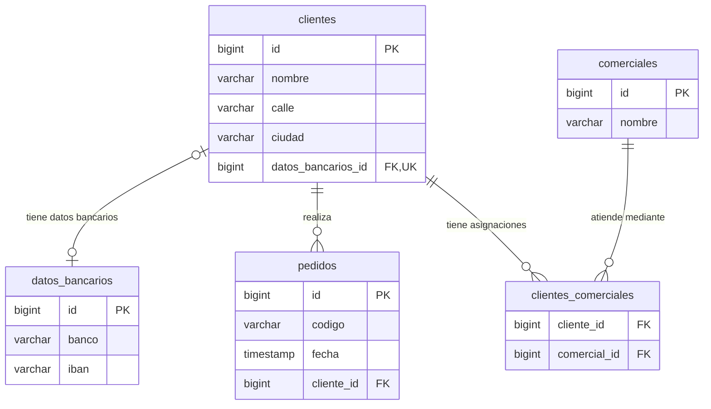

# Relaciones unidireccionales con JPA

Este módulo permite aprender a relacionar entidades de una manera simple y de manera unidireccional. H2 funciona por defecto; MariaDB de XAMPP se activa cambiando `persistence.xml`.

**Recorrido recomendado:** Despues de leer este README, empieza con el paquete `modelo.entidad` para ver las entidades y sus anotaciones, y despues empieza con las demostraciones `_01_DemoUnoAUno`, `_02_DemoUnoAMuchos` y `_03_DemoMuchosAMuchos`. 

## Qué vas a aprender

- **Relaciones 1 a 1:** Relacionar un cliente con sus datos bancarios mediante `@OneToOne`.
- **Relaciones embebidas:** Incluir los campos de un objeto en la tabla de otro con `@Embeddable` y `@Embedded`.
- **Relaciones 1 a N:** Representar uno-a-muchos desde el lado de cada pedido con `@ManyToOne`.
- **Relaciones N a M:** Relacionar clientes y comerciales con `@ManyToMany` y una tabla intermedia.
- Claves foráneas de una tabla intermedia y cascadas en JPA.

Los requisitos generales están en el [README raíz](../README.md). No necesitas Tomcat para este ejemplo.

## Conceptos clave para empezar

### Diagrama de las tablas

Este es el esquema que representan las entidades del ejemplo. Los tipos se muestran de forma simplificada: `PK` indica clave primaria, `FK` clave foránea y `UK` un valor único.



Cómo leerlo:

- **Uno a uno:** `clientes.datos_bancarios_id` apunta a `datos_bancarios.id` y no se puede repetir. La relación es opcional en este modelo: un cliente puede no tener datos bancarios.
- **Uno a muchos:** un cliente puede tener cero o muchos pedidos; cada pedido pertenece a un único cliente mediante `pedidos.cliente_id`.
- **Muchos a muchos:** cada fila de `clientes_comerciales` asocia un cliente con un comercial. Así un cliente puede tener varios comerciales y un comercial varios clientes.
- **Dirección embebida:** `calle` y `ciudad` están en `clientes`; no hay tabla `direcciones`.

En las líneas, `||` significa exactamente uno, `o|` cero o uno y `o{` cero o muchos. 

### Relacionar objetos y tablas

En Java podemos relacionar objetos mediante atributos: un pedido **tiene un** `Cliente` y un cliente **tiene una** lista de comerciales. Son relaciones de asociación entre objetos, que se pueden expresar con **«tiene un»** o **«pertenece a»**.

Las anotaciones indican cómo guardar esas referencias en la base de datos. Una **clave foránea (FK)** es una columna —o conjunto de columnas— que referencia una clave de otra tabla, normalmente su clave primaria. Su función es **relacionar los registros y mantener la integridad referencial**: si un pedido indica un cliente, ese cliente debe existir. Por ejemplo, `pedidos.cliente_id` guarda el valor de `clientes.id`, no una copia de todos los datos del cliente.

La ubicación de las claves foráneas depende del tipo de relación:

| Relación | Dónde se guarda la FK | Ejemplo del módulo |
| --- | --- | --- |
| **Uno a muchos (1:N)** | En la tabla del lado **N**. Cada registro de ese lado referencia al registro del lado 1. | `pedidos.cliente_id` apunta a `clientes.id`: varios pedidos pueden guardar el mismo ID de cliente. |
| **Uno a uno (1:1)** | Puede elegirse una de las dos tablas. La FK debe ser **única** para impedir que varios registros referencien al mismo registro del otro lado. | Hemos elegido `clientes.datos_bancarios_id`, que apunta a `datos_bancarios.id` y tiene una restricción `UNIQUE`. |
| **Muchos a muchos (N:M)** | En una **tabla intermedia**, con una FK hacia cada una de las tablas relacionadas. Cada fila representa una asociación. | `clientes_comerciales` guarda `cliente_id` y `comercial_id`. Un cliente puede aparecer en varias filas con comerciales distintos, y viceversa. |

La FK también interviene al borrar: si intentamos eliminar un cliente que todavía tiene pedidos, la base de datos impedirá dejar esos pedidos apuntando a un cliente inexistente. En este ejemplo, debemos resolver esas referencias antes de eliminarlo.

### Relacionar entidades mediante anotaciones

En JPA utilizamos anotaciones para indicar cómo se relacionan las entidades y cómo se representan esas relaciones en las tablas de la base de datos. En estos ejemplos utilizaremos las siguientes:

| Concepto | Anotación | Dirección en Java | Resultado en la base |
| --- | --- | --- | --- |
| Objeto embebido | `@Embedded` / `@Embeddable` | `Cliente → Direccion` | `calle` y `ciudad` son columnas de `clientes`; no existe tabla `direcciones`. |
| Uno a uno | `@OneToOne` y `@JoinColumn` | `Cliente → DatosBancarios` | `clientes.datos_bancarios_id` es una FK única hacia `datos_bancarios`. |
| Uno a muchos | `@ManyToOne` y `@JoinColumn` | `Pedido → Cliente` | Cada fila de `pedidos` lleva `cliente_id`. Varios pedidos pueden tener el mismo cliente. |
| Muchos a muchos | `@ManyToMany` y `@JoinTable` | `Cliente → Comercial` | `clientes_comerciales` guarda las dos FK. |

Para este ejemplo vamos a hacer las clases en POO mediante relaciones unidireccionales. **Unidireccional** significa que solo una clase tiene una referencia Java a la otra. `Cliente` no tiene `List<Pedido>`: para encontrar sus pedidos se consulta `Pedido` con JPQL. `DatosBancarios` y `Comercial` tampoco guardan una referencia de vuelta al cliente. La relación de uno a muchos existe en la base aunque en Java naveguemos únicamente de cada pedido a su cliente.

La dirección es una excepción a esa idea de relación: `Direccion` es un objeto Java, pero **no es una entidad ni tiene identidad propia en la base**. Se incluyen sus atributos en la tabla `clientes` como campos.

### Dirección embebida: un objeto sin tabla propia

Una dirección agrupa calle y ciudad en un objeto Java, pero sus datos se guardan en la misma fila que el cliente. No tiene ID ni tabla propia. Marcamos la clase como embebible y el atributo del cliente como embebido.

En `Direccion` (se omiten constructores y getters):

```java
@Embeddable
public class Direccion {
    private String calle;
    private String ciudad;
}
```

Dentro de `Cliente`:

```java
@Embedded
private Direccion direccion;
```

Al guardar el cliente con `gestor.persist(cliente)`, JPA incluye calle y ciudad en la tabla `clientes` como campos. No se guarda la dirección por separado.

### Uno a uno: cliente y datos bancarios

Cada cliente puede tener unos datos bancarios propios. La FK se guarda en `clientes` y apunta al ID de `datos_bancarios`.

Dentro de `Cliente`:

```java
@OneToOne(cascade = CascadeType.PERSIST)
@JoinColumn(name = "datos_bancarios_id", unique = true)
private DatosBancarios datosBancarios;
```

Utilizamos `CascadeType.PERSIST` porque queremos propagar únicamente el alta. `Cascade.ALL` también propagaría otras operaciones, como el borrado de los datos bancarios al eliminar al cliente. Debemos elegir las cascadas según las operaciones que necesitamos propagar.

Utilizamos `unique = true` para impedir que dos clientes compartan la misma fila de datos bancarios. 
Por ejemplo, imaginemos que tenemos esta fila en `datos_bancarios`:

| id | banco |
| --- | --- |
| 10 | Banco de ejemplo |

Sin la restricción `UNIQUE`, podríamos guardar estos dos clientes:

| id | nombre | datos_bancarios_id |
| --- | --- | --- |
| 1 | Ana | 10 |
| 2 | Luis | 10 |

Ambos apuntarían a la **misma fila** de datos bancarios: sería una relación muchos a uno. Con `unique = true`, la base impide repetir el valor `10` en `clientes.datos_bancarios_id`: si Ana ya lo utiliza, Luis tendrá que referenciar otra fila. Así cada fila de datos bancarios puede estar asociada, como máximo, a un cliente.


De esta manera, para dar de alta un cliente con su dirección y datos bancarios podriamos hacer algo como lo que está en el ejemplo `_01_DemoUnoAUno`:

```java
Cliente cliente = new Cliente("Ana", new Direccion("Calle Mayor, 1", "Madrid"));
cliente.setDatosBancarios(new DatosBancarios("Banco de ejemplo", "CUENTA-DEMO"));
gestor.persist(cliente); // La cascada también guarda sus datos bancarios.
```

El ID de ambas entidades lo genera la base de datos mediante `GenerationType.IDENTITY`.  Nótese que solo hemos persistido el cliente con `persist(cliente)` y no al objeto `DatosBancarios`, esto funciona gracias al `cascade = CascadeType.PERSIST`, que propaga **el alta** desde el cliente a sus datos bancarios.


### Uno a muchos: varios pedidos de un cliente

Un cliente puede tener varios pedidos y cada pedido pertenece a un cliente. La FK está en `pedidos`, el lado «muchos», además de que varias filas pueden contener el mismo ID de cliente. La relación es obligatoria: no se permite guardar un pedido sin cliente.

Dentro de `Pedido`:

```java
@ManyToOne(optional = false)
@JoinColumn(name = "cliente_id", nullable = false)
private Cliente cliente;
```

La fecha del pedido utiliza `LocalDateTime`, que JPA mapea sin una anotación adicional para la fecha. Con el tipo antiguo `java.util.Date`, utilizaríamos `@Temporal`.

Podemos ver un ejemplo de esta relación en el ejemplo `_02_DemoUnoAMuchos`. El método`crearPedidos` guarda primero a Beatriz y después dos pedidos que apuntan a ella. No hay cascada desde `Pedido` hacia `Cliente` así que debemos hacer un `persist()`de cada objeto explícitamente. 

Para obtener todos los pedidos de ese cliente usamos JPQL:

```java
List<Pedido> pedidos = gestor.createQuery(
        "select p from Pedido p where p.cliente.id = :id order by p.id", Pedido.class)
        .setParameter("id", idCliente)
        .getResultList();
```

| Parte | Qué significa |
| --- | --- |
| `select p from Pedido p` | Devuelve objetos `Pedido`; `p` es el alias de la entidad. |
| `where p.cliente.id = :id` | Selecciona los pedidos cuyo cliente tiene el ID indicado. |
| `order by p.id` | Ordena los pedidos por su identificador. |

`:id` es un parámetro al que asignamos el ID generado con `setParameter("id", idCliente)`. La consulta utiliza entidades y propiedades Java, como en el [ejemplo 09](../09_JPA/README.md#consultar-con-jpql).

### Muchos a muchos: clientes y comerciales

Un cliente puede tener varios comerciales y un comercial puede atender a varios clientes. Para guardar las asociaciones utilizamos una tabla intermedia con una FK hacia cada entidad. Para replicarlo en Java, el cliente contiene una lista de comerciales; el comercial no tiene una lista de clientes.

Dentro de `Cliente`:

```java
@ManyToMany
@JoinTable(name = "clientes_comerciales",
        joinColumns = @JoinColumn(name = "cliente_id"),
        inverseJoinColumns = @JoinColumn(name = "comercial_id"))
private List<Comercial> comerciales = new ArrayList<>();
```

`joinColumns` identifica la FK hacia la entidad donde está el atributo (`Cliente`); `inverseJoinColumns`, la FK hacia `Comercial`.

En el ejemplo `_03_DemoMuchosAMuchos`, en el método`asignarComerciales`, primero se persisten los comerciales Lucía y Mario, y después los clientes Carmen y Diego. Carmen se asocia a ambos comerciales y Diego a Lucía, reutilizando el mismo objeto. Al confirmar, JPA inserta tres asociaciones en la tabla intermedia, pero solo dos comerciales. Añadir un comercial nuevo a esa lista **no lo guarda automáticamente**, porque no hay `CascadeType.PERSIST` en `@ManyToMany`. El orden exacto de los `INSERT` lo decide el proveedor JPA; no se debe deducir el ID de un objeto por el orden en que aparece en el código.

Después de guardar los dos comerciales y los dos clientes, dentro de la misma transacción:

```java
carmen.getComerciales().add(lucia);
carmen.getComerciales().add(mario);
diego.getComerciales().add(lucia); // Comparte el mismo comercial, sin duplicarlo.
```

### Cascadas: qué se propaga y qué no

Una cascada no es una dirección de navegación: indica qué operación JPA se propaga a los objetos referenciados. En este ejemplo:

| Asociación | Cascada usada | Consecuencia |
| --- | --- | --- |
| `Cliente → DatosBancarios` | `PERSIST` | Dar de alta un cliente nuevo también guarda sus datos bancarios nuevos. No se propaga el borrado. |
| `Pedido → Cliente` | Ninguna | Cada pedido se guarda por separado y nunca borra a su cliente por cascada. |
| `Cliente → Comercial` | Ninguna | Los comerciales se guardan antes y no se borran al actuar sobre un cliente. |

### Transacciones y cierre de recursos

Cada operación abre su propio `EntityManager` y utiliza `begin()` y `commit()`, incluidas las consultas. `try-with-resources` cierra los recursos; `finally` ejecuta `rollback()` si la transacción sigue activa. La factoría se abre una vez por demostración y se cierra al terminar.

### Fichero `persistence.xml`

La unidad `RelacionesJPA` declara las cuatro entidades: `Cliente`, `DatosBancarios`, `Pedido` y `Comercial`. `Direccion` es embebida y no se declara como entidad. Las tres demostraciones utilizan la misma configuración.

La conexión predeterminada es H2 en archivo. Utilizamos `hibernate.hbm2ddl.auto=create`: cada demostración recrea todas las tablas de la unidad y borra los datos anteriores. Al finalizar, las tablas y los datos quedan disponibles para inspeccionarlos; debes hacerlo antes de ejecutar otra demostración. Las opciones se explican en el [README del 09](../09_JPA/README.md#creación-y-actualización-de-las-tablas).

## Estructura relevante

```text
10_JPARelaciones/
├── pom.xml
├── sql/mariadb.sql
└── src/main/
    ├── java/
    │   ├── main/_01_DemoUnoAUno.java
    │   ├── main/_02_DemoUnoAMuchos.java
    │   ├── main/_03_DemoMuchosAMuchos.java
    │   └── modelo/entidad/{Cliente,Direccion,DatosBancarios,Pedido,Comercial}.java
    └── resources/META-INF/persistence.xml
```

## Demostraciones y orden recomendado

| Orden | Clase que debes ejecutar | Qué muestra |
| --- | --- | --- |
| 01 | `main._01_DemoUnoAUno` | Ana con una dirección embebida y unos datos bancarios asociados mediante `@OneToOne`. |
| 02 | `main._02_DemoUnoAMuchos` | Beatriz con dos pedidos, `PED-A` y `PED-B`. Cada pedido apunta al cliente mediante `@ManyToOne`. |
| 03 | `main._03_DemoMuchosAMuchos` | Carmen tiene a Lucía y Mario como comerciales; Diego comparte a Lucía. Se guardan tres asociaciones en la tabla intermedia. |

Los números indican el orden de aprendizaje. **Cada demostración crea sus propios datos y puede ejecutarse sin haber ejecutado las anteriores.

## Cómo ejecutar con H2

La configuración incluida usa `jdbc:h2:file:~/wsdwes_10_relaciones`. El archivo `wsdwes_10_relaciones.mv.db` se crea en la carpeta personal del usuario.

La unidad `RelacionesJPA` utiliza Hibernate y `hibernate.hbm2ddl.auto=create` para comenzar desde cero en cada ejecución. A diferencia de `create-drop`, las tablas no se eliminan al cerrar la factoría, y de esta manera, podemos inspeccionar la base de datos para ver los resultados.

Cada demostración abre una factoría con `try-with-resources`, guarda sus datos y los consulta con un nuevo `EntityManager`. 

## Cómo comprobar que funciona

1. `_01_DemoUnoAUno`: aparecen Ana, Madrid y Banco de ejemplo. En `clientes` se guardan la dirección y una FK única hacia `datos_bancarios`; no existe una tabla de direcciones.
2. `_02_DemoUnoAMuchos`: aparecen `PED-A` y `PED-B`, ambos asociados al mismo ID de Beatriz. Comprueba que sus filas de `pedidos` comparten `cliente_id`.
3. `_03_DemoMuchosAMuchos`: Carmen muestra a Lucía y Mario; Diego muestra a Lucía con el mismo ID que en Carmen. Para esos dos clientes hay tres filas en `clientes_comerciales` y solo dos comerciales nuevos.

## Errores frecuentes

- Esperar una tabla `direcciones`: `Direccion` es embebida, no entidad.
- Añadir un pedido sin cliente: `cliente_id` no admite `null`.
- Persistir un comercial nuevo solo por añadirlo a `cliente.getComerciales()`: esta relación no tiene cascada; hay que persistirlo antes.
- Acceder a `cliente.getComerciales()` después de cerrar el `EntityManager` sin haber cargado la colección.

## Alternativa con MariaDB de XAMPP

1. Inicia **MySQL** en XAMPP y ejecuta [sql/mariadb.sql](sql/mariadb.sql) desde phpMyAdmin para crear la base `dwes_10`.
2. En `src/main/resources/META-INF/persistence.xml`, sustituye las cuatro propiedades JDBC de H2 por estas, ajustando puerto, usuario y contraseña a tu instalación:

   ```xml
   <property name="jakarta.persistence.jdbc.driver" value="org.mariadb.jdbc.Driver"/>
   <property name="jakarta.persistence.jdbc.url" value="jdbc:mariadb://localhost:3306/dwes_10"/>
   <property name="jakarta.persistence.jdbc.user" value="usuario_local"/>
   <property name="jakarta.persistence.jdbc.password" value="contraseña_local"/>
   ```

3. Ejecuta cada demostración y, antes de ejecutar la siguiente, comprueba en phpMyAdmin las tablas `clientes`, `datos_bancarios`, `pedidos`, `comerciales` y `clientes_comerciales`. Verifica sus FK siguiendo las comprobaciones anteriores: cada demostración recrea las tablas y utiliza sus propios clientes.

Para volver a H2 restaura driver `org.h2.Driver`, URL `jdbc:h2:file:~/wsdwes_10_relaciones`, usuario `sa` y contraseña vacía.

## Propuestas para practicar

1. En la demostración `_03_DemoMuchosAMuchos`, asocia también a Mario con Diego. Comprueba que se crea una cuarta asociación sin duplicar comerciales.
2. En la demostración `_02_DemoUnoAMuchos`, añade un tercer pedido a Beatriz y muestra el número de pedidos obtenido mediante JPQL.
3. Consulta los clientes que atiende un comercial mediante JPQL sin añadir `List<Cliente>` a `Comercial`.

## Ampliación avanzada sobre las relaciones

**Esta parte puede dejarse para después de ejecutar las tres demostraciones.** 

Los fragmentos siguientes ilustran conceptos más avanzados sobre las relaciones; no es necesario incorporarlos a las entidades para ejecutar las demostraciones. Se omiten los imports y los métodos que no afectan a cada explicación.

### Carga de relaciones y `EntityManager`

La carga puede ser **inmediata/ansiosa** (`EAGER`) o **diferida/perezosa** (`LAZY`). 
- Con `EAGER`, la relación debe quedar disponible al obtener la entidad. 
- Con `LAZY`, el proveedor puede esperar hasta que accedamos a la relación para traerla. 

Por defecto, `@OneToOne` y `@ManyToOne` son `EAGER`, mientras que `@ManyToMany` es `LAZY`.

En el ejemplo `_03_DemoMuchosAMuchos`, dentro del método `consultarClientes`, accede a `cliente.getComerciales()` **antes de cerrar** el `EntityManager`, de esta manera, se puede cargarse la colección diferida. Si se cerrase primero y la colección todavía no estuviera cargada, Hibernate lanzaría un error al intentar recorrerla. Por otra parte, la consulta de pedidos también se ejecuta con el gestor abierto, por la misma razon. 

Evita la idea de que `find(cliente)` trae siempre, y de una vez, todo el grafo de objetos: el momento y número de consultas depende de la estrategia de carga y del proveedor.

Podemos indicar la carga diferida/perezosa explícitamente en `Cliente` (es el valor predeterminado de esta relación):

```java
@ManyToMany(fetch = FetchType.LAZY)
@JoinTable(name = "clientes_comerciales",
        joinColumns = @JoinColumn(name = "cliente_id"),
        inverseJoinColumns = @JoinColumn(name = "comercial_id"))
private List<Comercial> comerciales = new ArrayList<>();
```

Dentro de la transacción de consulta, con el gestor abierto:

```java
Cliente cliente = gestor.find(Cliente.class, idCliente);
// Al recorrer la colección, Hibernate puede consultar los comerciales.
for (Comercial comercial : cliente.getComerciales()) {
    System.out.println(comercial.getNombre());
}
```

### Otras cascadas

Las cascadas indican qué operaciones realizadas sobre una entidad se propagan a los objetos de un atributo relacionado. En `Cliente.datosBancarios`, la propagación va del cliente hacia sus datos bancarios, no al revés.

| Opción | Qué propaga | Ejemplo con cliente y datos bancarios |
| --- | --- | --- |
| `PERSIST` | El alta mediante `persist`. | Al guardar un cliente nuevo, también se guardan sus datos bancarios nuevos. |
| `MERGE` | La copia del estado mediante `merge`. | Al fusionar un cliente separado de su gestor, también se copia el estado de sus datos bancarios a una entidad gestionada. |
| `REMOVE` | El borrado mediante `remove`. | Al eliminar al cliente, también se eliminan sus datos bancarios. |
| `REFRESH` | La recarga desde la base mediante `refresh`. | Al recargar un cliente gestionado, también se recargan sus datos bancarios. Se reemplazan los valores en memoria, perdiendo los cambios que todavía no se hayan guardado. |
| `DETACH` | La separación del contexto mediante `detach`. | Al dejar de gestionar al cliente, el gestor también deja de gestionar sus datos bancarios. No se borran de la base; sus cambios posteriores ya no se guardan automáticamente. |
| `ALL` | Las cinco operaciones anteriores. | Se propagan `PERSIST`, `MERGE`, `REMOVE`, `REFRESH` y `DETACH`. |

Sin `cascade`, estas operaciones no se propagan automáticamente por esa relación. Podemos seleccionar varias sin utilizar `ALL`. Por ejemplo, si queremos propagar el alta y la fusión, pero no el borrado:

```java
@OneToOne(cascade = {CascadeType.PERSIST, CascadeType.MERGE})
@JoinColumn(name = "datos_bancarios_id", unique = true)
private DatosBancarios datosBancarios;
```

`MERGE` es relevante cuando utilizamos `merge` con objetos separados; no hace falta para detectar los cambios realizados mediante setters sobre entidades que ya están gestionadas.

Las cascadas deben elegirse según el ciclo de vida de los objetos: propagar el borrado hacia un comercial compartido podría afectar a otros clientes. En el código de las demostraciones solo utilizamos `PERSIST` entre cliente y datos bancarios.

Si decidiéramos que borrar un cliente también debe borrar sus datos bancarios, podríamos sustituir la configuración de ese atributo por:

```java
@OneToOne(cascade = {CascadeType.PERSIST, CascadeType.REMOVE})
@JoinColumn(name = "datos_bancarios_id", unique = true)
private DatosBancarios datosBancarios;
```

Entonces, dentro de una transacción:

```java
Cliente cliente = gestor.find(Cliente.class, idCliente);
if (cliente != null) {
    gestor.remove(cliente); // También elimina sus datos bancarios al confirmar.
}
```

Este borrado requiere resolver antes otras referencias al cliente, como sus pedidos. La cascada no elimina esas restricciones ni debe aplicarse indiscriminadamente a los comerciales compartidos.

### Relaciones bidireccionales

En una relación bidireccional como `Cliente ↔ Pedido`, las dos clases tienen atributos para navegar en ambos sentidos. En ese diseño, la colección de pedidos de `Cliente` utiliza `mappedBy` para señalar el atributo `cliente` de `Pedido`, donde se configura la FK. El programa debe mantener coherentes las referencias Java: asignar el cliente al pedido y añadir el pedido a la lista del cliente. Omitir una de ellas puede dar una imagen inconsistente en memoria. Aquí conservamos solo `Pedido → Cliente` para centrarnos en cómo se almacenan las claves foráneas.

En `Cliente`, añadiríamos la colección y un método que mantenga ambos lados:

```java
@OneToMany(mappedBy = "cliente")
private List<Pedido> pedidos = new ArrayList<>();

public void agregarPedido(Pedido pedido) {
    pedidos.add(pedido);
    pedido.setCliente(this);
}
```

En `Pedido`, conservaríamos la relación actual y añadiríamos el setter:

```java
@ManyToOne(optional = false)
@JoinColumn(name = "cliente_id", nullable = false)
private Cliente cliente;

public void setCliente(Cliente cliente) {
    this.cliente = cliente;
}
```

`mappedBy = "cliente"` menciona el **atributo Java de `Pedido`**, no la columna `cliente_id`. El método `agregarPedido` mantiene las referencias en memoria; no guarda el pedido automáticamente, porque aquí no hemos añadido cascadas.

#### Variante con cascada desde el cliente hacia sus pedidos

Si queremos dar de alta un cliente junto con sus pedidos nuevos, podemos añadir `PERSIST` a la colección de `Cliente`:

```java
@OneToMany(mappedBy = "cliente", cascade = CascadeType.PERSIST)
private List<Pedido> pedidos = new ArrayList<>();
```

Conservamos el método `agregarPedido` anterior para mantener ambos lados de la relación. Dentro de una transacción, crearíamos los objetos así:

```java
Cliente cliente = new Cliente("Beatriz", new Direccion("Calle Sol, 2", "Sevilla"));
Pedido primero = new Pedido("PED-A", LocalDateTime.now(), cliente);
Pedido segundo = new Pedido("PED-B", LocalDateTime.now(), cliente);

cliente.agregarPedido(primero);
cliente.agregarPedido(segundo);
gestor.persist(cliente); // También guarda los dos pedidos nuevos por la cascada.
```

No necesitamos llamar a `persist` para cada pedido. La propagación va **del cliente hacia sus pedidos**, mientras que la FK sigue estando en `pedidos.cliente_id`: la cascada no cambia dónde se guarda la relación ni sustituye la asignación de ambos lados en Java.

Usamos `PERSIST` para propagar el alta, sin propagar el borrado. Esta variante muestra el alta de un cliente nuevo con sus pedidos nuevos; el ejemplo `_02_DemoUnoAMuchos` mantiene el diseño unidireccional y el guardado explícito.

### Asociaciones con datos propios

La tabla intermedia generada por `@ManyToMany` solo representa la asociación. Si la relación necesitase datos propios —por ejemplo, fecha de asignación o comisión— sería mejor crear una entidad `AsignacionComercial` para esa tabla y relacionarla con `Cliente` y `Comercial`. Eso se deja fuera de este módulo para mantener clara la idea principal.

Una posible entidad para guardar la fecha de cada asignación sería:

```java
@Entity
@Table(name = "asignaciones_comerciales")
public class AsignacionComercial {
    @Id
    @GeneratedValue(strategy = GenerationType.IDENTITY)
    private Long id;

    @ManyToOne(optional = false)
    @JoinColumn(name = "cliente_id", nullable = false)
    private Cliente cliente;

    @ManyToOne(optional = false)
    @JoinColumn(name = "comercial_id", nullable = false)
    private Comercial comercial;

    private LocalDate fechaAsignacion;

    protected AsignacionComercial() {
    }

    public AsignacionComercial(Cliente cliente, Comercial comercial, LocalDate fecha) {
        this.cliente = cliente;
        this.comercial = comercial;
        this.fechaAsignacion = fecha;
    }
}
```

Dentro de una transacción, usando un cliente y un comercial ya gestionados:

```java
AsignacionComercial asignacion =
        new AsignacionComercial(cliente, comercial, LocalDate.now());
gestor.persist(asignacion);
```

Este diseño **sustituiría** el `@ManyToMany` y su tabla intermedia; no mantendríamos ambas formas de representar la misma asociación. También habría que declarar la nueva entidad en `persistence.xml`.

## Bibliografía

### Recursos en español

Estos materiales son didácticos y no forman parte de la documentación oficial de Jakarta o Hibernate:

- [Relaciones JPA — IES San Clemente](https://manuais.pages.iessanclemente.net/plantillas/dam/ad/03orm/jpa/06relaciones/index.html): apuntes de Acceso a Datos con ejemplos de cardinalidad, relaciones unidireccionales y bidireccionales, claves foráneas y tablas intermedias.
- [OneToMany y sus anotaciones — makigas](https://www.makigas.es/series/jpa-hibernate/onetomany-anotaciones): explicación y vídeo sobre la relación uno a muchos, `mappedBy` y la carga de colecciones.

### Documentación oficial en inglés

- [Introducción a Jakarta Persistence](https://jakarta.ee/learn/docs/jakartaee-tutorial/current/persist/persistence-intro/persistence-intro.html): explicación de entidades, relaciones y gestores de entidades.
- [Tutorial de JPQL](https://jakarta.ee/learn/docs/jakartaee-tutorial/current/persist/persistence-querylanguage/persistence-querylanguage.html): consultas sobre entidades y sus propiedades.
- [API de Jakarta Persistence 3.2](https://jakarta.ee/specifications/persistence/3.2/apidocs/): referencia de anotaciones como `OneToOne`, `ManyToOne`, `ManyToMany`, `JoinColumn` y `CascadeType`, con sus parámetros y valores predeterminados.
- [Documentación de Hibernate ORM 7.4](https://hibernate.org/orm/documentation/7.4/): acceso a la guía introductoria y al manual detallado de Hibernate, la implementación utilizada en este módulo.
- [Especificación de Jakarta Persistence 3.2](https://jakarta.ee/specifications/persistence/3.2/jakarta-persistence-spec-3.2.html): referencia avanzada con las reglas completas del estándar.
